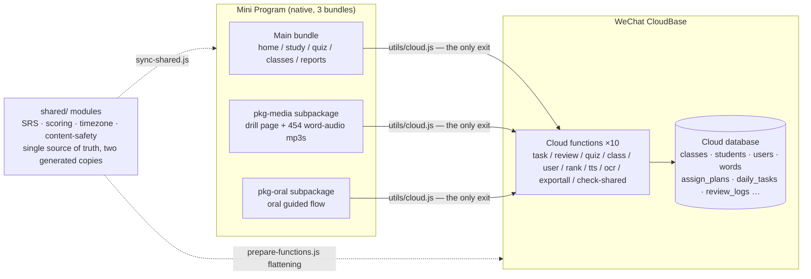

<div align="center">

# wordCheck (单词抽查)

**Vocabulary drilling + spaced-repetition review + real teacher-side spot checks — a WeChat Mini Program (native + WeChat CloudBase)**

[](LICENSE)
[](#testing-no-devtools-no-dependencies)
[](https://developers.weixin.qq.com/miniprogram/dev/framework/)
[](https://developers.weixin.qq.com/miniprogram/dev/wxcloud/basis/getting-started.html)
[](#why-i-stopped-two-structural-deadlocks)

[简体中文](README.md) | English

</div>

---

> ### ⚠️ This project is no longer actively maintained (Nov 2026)
>
> The mini program was released and used in the real world (production release plus many
> trial-version iterations). The code is feature-complete and `npm run check` is fully green.
> But an indie developer building a K12 textbook-synced vocabulary app runs into two
> **structural deadlocks** (see [Why I stopped](#why-i-stopped-two-structural-deadlocks));
> continuing could never pay off, so the project is open-sourced and parked.
>
> - Want to run it → [Quick start](#getting-started-10-minutes); the code runs out of the box
> - Want to continue it → the roadmaps are already written: [SOE scoring integration](docs/SOE对接方案.md)
>   and [next-generation class assignments](docs/班级作业改版方案.md) (both in Chinese)
> - Want to contribute → **[vocabulary PRs](#contributing-a-wordlist-the-most-welcome-pr) are what this project needs most**
> - Want to avoid the same traps → read [Why I stopped](#why-i-stopped-two-structural-deadlocks) first

The core of the product is not the word list — it is the closed loop
**assign → study → get spot-checked → results visible to a third party**:
whether a kid actually studied, and how well, is directly visible to the teacher on their phone.
No more collecting notebooks and checking word by word.

## Features

| Module | Notes |
| --- | --- |
| Flashcard | Whole-card swipe-up gesture, tap or 8-second auto reveal, three-level self rating |
| Spelling keyboard | Three difficulty tiers that auto-progress: correct letters only → confusable letters (b/d, i/l/r/u…) → full keyboard |
| SRS review | Forgetting-curve tiers drive "what to study today"; wrong words flow back into today's queue automatically |
| **Oral read-aloud** | Guided flow: level-by-level demonstration → oral spot check (no demo audio) → written drilling → merged report; replayable until everything is perfect |
| Scoring engine | On-device completion scoring in three tiers (**honest mode: does NOT judge pronunciation accuracy**); the scorer is pluggable — a real SOE engine is one `register()` call away (see the [plan](docs/SOE对接方案.md), in Chinese) |
| Word audio | Batch-generated offline with Piper (MIT); 454 words covered; missing audio degrades gracefully |
| **Classes (coach side)** | Join by invite code, assign by textbook unit or custom word list, split one assignment across N days automatically (daily 08:00 timer, idempotent), per-student status at a glance, one-tap nudge copy, daily digest subscription |
| Reports | Dedicated report page; save an A4-portrait long screenshot to the album and share to parents; oral + written results merged |
| Compliance | Privacy authorization guard, **every UGC entry point passes WeChat content-safety APIs** (msgSecCheck / imgSecCheck), minor-protection notices |
| Themes | 5 skins (night / sakura / honey / mint / sky), fully tokenized via CSS variables |
| Ads / payments | Not enabled (`utils/ads.js` reserved, `AD_UNITS` empty) |

## Architecture



Three hard rules that must never be broken (all six in [`docs/设计约定.md`](docs/设计约定.md), Chinese):

1. **Quiz answers never reach the client** — grading happens server-side only;
2. **Every write endpoint is idempotent** — carries a `clientReqId`, server checks before writing;
3. **"Today" is decided only by `shared/time.js`** — scattered `new Date()` is forbidden
   (UTC+8 day-boundary behavior is locked by 13 tests).

## Getting started (10 minutes)

1. **Point the config at your own resources** (both required):
   - `ENV_ID` in `miniprogram/utils/cloud.js` → your CloudBase environment ID
   - `appid` in `project.config.json` → your Mini Program AppID
   - ⚠️ The repo keeps the **original author's** environment ID and AppID. CloudBase
     authorizes by AppID, so your mini program cannot access it; if you skip this step
     cloud calls will fail with "environment not found" — that is expected, not a broken build.
2. Open **WeChat DevTools** → import project → select the repo root (it reads `project.config.json`).
3. Click **Cloud Development** in the toolbar, create an environment (use separate `dev` / `prod`),
   then deploy the 10 cloud functions and create the collection indexes following
   [`docs/云开发部署指南.md`](docs/云开发部署指南.md) (Chinese).
4. Build and run. When the cloud is unavailable the study page falls back to a local
   word list, so gestures, SRS and the wrong-word book all remain verifiable.

## Testing (no DevTools, no dependencies)

```bash
npm run check    # one command: shared-module drift check + project lint + binding/syntax check + all tests
npm test         # tests only: 50 test files, 676 assertions, plain node
```

Where this test suite comes from: the project was burned early by three classes of
"no console errors but the whole page is dead" bugs (duplicate attributes on one element,
`*/` inside comments closing a block comment early, `{{}}` interpolation inside `style`
resolving to undefined). All three are now automated assertions. Every real-device fix
(recording authorization races, dead buttons after screen-off, gesture stealing) follows a
**mutation-tested** rule: remove the fix, the matching assertion must turn red, then restore.
`tests/launch.test.js` even scans user-facing copy for forbidden legacy wording, guarding against regressions.

## Repository layout

```
miniprogram/            Native mini program
├─ pages/               Main bundle: home / study / quiz / classes / report / settings …
├─ components/          word-card (flashcard), footer-nav (custom tab bar)
├─ pkg-media/           Subpackage: drill page + assets/audio (454 Piper mp3s)
├─ pkg-oral/            Subpackage: oral guided flow (flow page)
├─ data/                Local word lists (script-generated, do not hand-edit)
├─ utils/               cloud.js (the only cloud exit), oral-score.js (pluggable scorer),
│                       oral.js / oral-flow.js, plus generated copies of shared modules
└─ theme-*.wxss         Skin tokens

cloud/functions/        Cloud functions: task / review / quiz / class / user / rank /
                        tts / ocr / exportall / check-shared

shared/                 Single source of truth (srs / quiz / time / wrong / seccheck / …)
scripts/                sync-shared / prepare-functions / verify-project / check-bindings /
                        build-waiyan / gen_audio_piper.py …
tests/                  Zero-dependency tests (50 files / 676 assertions)
```

**Why not an npm package for shared modules?** Mini programs and cloud functions can't
conveniently reference code across directories; "single source + script-generated copies +
fingerprint check" proved the least painful. Note the cloud-function copies must be
**flattened** into each function directory — a `shared/` subfolder compiled fine locally but
threw `Cannot find module` after CLI deployment; `scripts/prepare-functions.js` now enforces that.

## Contributing a wordlist — the most welcome PR

**The project's scarcest resource is word lists.** Only one exists
(Foreign Language Teaching & Research Press, Grade 4 Book 1, 2024 edition, 454 words).
Chinese primary-school English textbooks come in dozens of publisher × grade × volume
combinations, and one person can never record them all.

A new textbook is just one CSV:

```csv
unit,unit_name,unit_order,word,pos,def_cn,phonetic
1,I love sports,1,sport,n.,体育运动,/spɔːt/
1,I love sports,2,basketball,n.,篮球,/'ba:skitbɔ:l/
2,Helping at home,1,tidy,v.,整理；收拾,/'taidi/
```

| Field | Required | Notes |
| --- | --- | --- |
| `unit` / `unit_name` | ✅ | Unit number and name (used for "assign Unit 3") |
| `unit_order` | ✅ | Word order within the unit; **drives auto-assignment ordering**; must be consecutive |
| `word` / `pos` / `def_cn` | ✅ | Word, part of speech, Chinese definition |
| `phonetic` | ⬜ | IPA, optional |
| `example_en` / `example_cn` | ⬜ | Example sentences — **write your own**; definitions and sentences are copyrighted works, do not copy dictionaries |

Submit the CSV in a PR; a maintainer runs the scripts to generate `words.js` / `booktree.js`
(see `scripts/build-waiyan.js`), and `scripts/gen_audio_piper.py` batch-generates the audio.
Missing audio degrades to silent cards — it never crashes.

Other PRs (bug fixes, doc corrections, new cloud-function tests) are welcome too.
For large UI redesigns please open an issue first — the project is unmaintained, so merges
keep the hard rule "don't break the existing test suite".

## Why I stopped: two structural deadlocks

Written down so the next indie developer doesn't step on the same rakes.

**Deadlock 1 · wordlist coverage vs mismatched demand (cold start)**
People who don't need your textbook won't use the app; people who need it can't find their
textbook in it. Chinese primary-school English textbooks = publisher (PEP / FLTRP / Yilin /
Oxford Shanghai / Beijing Normal / Hebei…) × grade × volume — dozens of combinations.
Recording one list takes hours and serves only the users of that exact book.
**The moment a parent is most willing to pay is precisely the moment they discover
"our textbook isn't here".**

**Deadlock 2 · the user, the distributor and the payer are three different people**
- The kid uses it, but pays nothing and has no say;
- Teachers are the **best distribution node** (one teacher = 40 kids + 40 parents), but
  **individuals don't pay for teaching tools** — in China the K12 software budget sits with
  schools/institutions, not with teachers' salaries. Teachers only adopt when "the school
  bought it and mandates it";
- Parents are the only ones who might pay, but at a low ticket size (¥9.9–39), with high
  acquisition cost and the textbook-coverage problem on top.

The result: **acquisition depends on teachers, revenue on parents, retention on word lists** —
all three legs need investment before break-even, and an indie developer can't fund that.

These deadlocks hold for any indie developer building K12 textbook-synced content; it is not
an execution problem. If you plan to continue, the only viable starting point is holding
**both** "one word list" and "one teacher willing to pilot a whole class" — missing either,
don't start. The roadmaps for what comes next are already written:
[next-generation class assignments](docs/班级作业改版方案.md) and
[SOE scoring integration](docs/SOE对接方案.md) (both in Chinese).

## License

[MIT](LICENSE). Keep respecting upstream content licenses for word lists
(ECDICT / MIT; write your own example sentences — never copy dictionaries).
