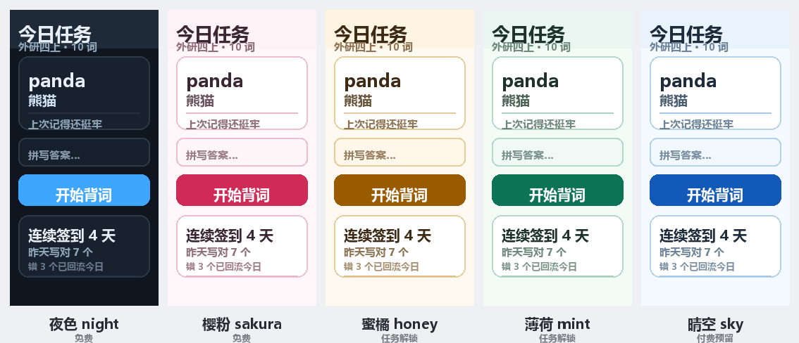
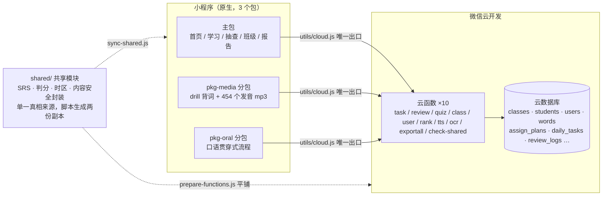

<div align="center">

# 单词抽查 · wordCheck

**背单词 + 遗忘曲线复习 + 真·抽查督促 的微信小程序（原生 + 云开发）**

[](LICENSE)
[](#本地校验不需要开发者工具也不需要装依赖)
[](https://developers.weixin.qq.com/miniprogram/dev/framework/)
[](https://developers.weixin.qq.com/miniprogram/dev/wxcloud/basis/getting-started.html)
[](#为什么停结构性死结和资源问题)

简体中文 | [English](README.en.md)

</div>

---

> ### ⚠️ 本项目已停止活跃维护（2026-11）
>
> 小程序已上线并真实使用过一段时间（正式版 + 多轮体验版迭代），代码功能完整、`npm run check` 全绿。
> 但个人开发者做 K12 同步教辅有三个**结构性死结**（含最根本的资源与运营问题，见文末），继续投入无法回本，所以选择开源后停更。
>
> - 想跑起来看看 → 读 [快速开始](#跑起来10-分钟)，代码可开箱运行
> - 想接着做 → 读 [SOE 对接方案](docs/SOE对接方案.md) 与 [班级作业改版方案](docs/班级作业改版方案.md)，路线图都是现成的
> - 想贡献 → **[词库 PR](#贡献词库最欢迎的-pr) 是这个项目最缺的东西**
> - 想避免踩同样的坑 → 直接读文末 [为什么停](#为什么停结构性死结和资源问题)

---

<p align="center">
  
</p>

核心不是词库，而是 **「布置任务 → 学习 → 被抽查 → 结果可被第三方看见」** 这个闭环：
孩子学没学、学得怎么样，老师（教练）在手机上直接看得到，不用收本子一个一个对。

## 功能总览

> 以小程序当前代码为准（2026-11）。主线是「背词」入口的**口语贯穿式四阶段**，
> 下面按主流程顺序排；已下线的旧交互见文末「已移除 / 不再是主流程」。

| 模块 | 说明 |
| --- | --- |
| **① 口语带读** | 词 → 短句 → 小段，出现即主动发音、按住跟读；合格后**自动进下一条**，不合格给「下一个」按钮，最后自动进抽查 |
| **② 口语抽查** | 不给示范音、自己读一遍；没过的再过一轮（最多 2 轮）。不在这一层造选择题 |
| **③ 认 → 写 → 巩固（书面背词）** | 认＝听音 + 单词 + 音标，中文释义二选一（带【不会】诚实出口，5 秒提示 / 10 秒超时）；写＝听音 + 音标 + 中文，自绘键盘拼写，计时按字母数（约 2–3 秒/字母），拼错降回最简键盘；没拿下的词反复巩固到全对（上限 5 轮） |
| **④ 合并报告** | 口语与书面并到一张纸，列出待练条目，可**只重练没读流畅的**，不重跑书面 |
| 评分器 | 本机只判「有没有开口、读完没、连不连贯」三档（**诚实模式：不判发音准不准**）；评分器可插拔，`scorer.register/use` 留好接口，SOE 真评分一行注册切换（详见下文「真要继续还缺什么」与 [方案](docs/SOE对接方案.md)） |
| SRS 复习 | 遗忘曲线档位驱动「今天学什么」，错词在次日 / 第 3 天 / 第 7 天换题型强制复现 |
| 发音音频 | Piper 离线合成（MIT），454 词全量 mp3，缺音频自动降级不崩；口语课另走逐句音频 |
| 逐词用时 | 每个词如实记 `durationMs` 上报（含看详情、跟读停留），学习简报里的「学了多久」不是编的 |
| **班级（教练端）** | 邀请码建班/加入、按单元或自定义词单布置、一次设定分 N 天自动布置（每天 08:00 定时触发，幂等）、学员状态一览、一键催学文案、每日简报订阅 |
| 荣誉榜 / 反馈 | 今日 / 本周 / 本月最快三只「期内最快」榜；首页客服留言入口（真机进微信客服会话） |
| 报告长图 | 独立报告页，A4 竖版长图存相册、可直接转发家长 |
| 合规 | 隐私授权守卫、**全部 UGC 入口过内容安全 API**（msgSecCheck / imgSecCheck）、未成年人提示 |
| 皮肤 | 6 套主题（夜色 / 樱粉 / **糖果** / 蜜橘 / 薄荷 / 晴空），全站 token 化，CSS 变量一键切换，完成任务可解锁 |
| 广告 / 付费 | 未启用（`utils/ads.js` 预留、`AD_UNITS` 全空） |

**已移除 / 不再是主流程**（代码仍在，但不是用户路径）：
- **整卡上滑 + 点按/8 秒揭晓 + 三档自评**：旧「学习页」（study）的翻卡自评，2026-10-07 起主学习流改为「认 → 写」客观判分，旧页退为备用路径，上滑组件保留但不再出现在主流程。
- **独立抽查页（quiz，交卷制考试模式）**：已退役，首页「去抽查」入口删除、底部导航去掉抽查；代码暂留供旧 study 流程与测试引用。

### 真要继续，还缺什么（都已铺好路，缺的是资源不是方案）

| 缺口 | 现状 / 落点 |
| --- | --- |
| **真·发音评分（SOE）** | 当前「读得顺不顺」是本机能量判定的诚实档位，**不判发音准不准**。腾讯云 SOE 的完整路线（接口签名、计费、儿童语音合规、代码落点）写在 [`docs/SOE对接方案.md`](docs/SOE对接方案.md)：SecretKey 只放云函数、端上拿一次性签名，评分器换引擎时主流程一行不改。**这是口语闭环唯一还缺的硬能力** |
| **词库覆盖** | 教材版本 × 年级 × 上下册是冷启动死结（见下）。已有批量导入 + OCR（识别后必须人工核对）、自建词库流程；最缺的还是「正好这一本」的词表，[词库 PR](#贡献词库最欢迎的-pr) 最欢迎 |
| **机构 / 渠道分发** | 班级作业闭环已可用（布置 → 学习 → 被抽查 → 家长可见），下一代改版见 [`docs/班级作业改版方案.md`](docs/班级作业改版方案.md)；但从「产品能用」到「有机构愿意整班用」这一步没有打通 |
| **运营 / 推广** | 老师向视频脚本、审核整改实录等一手样本在 [`docs/开发与运营路线.md`](docs/开发与运营路线.md) 与 [`docs/审核整改-2026-11-16.md`](docs/审核整改-2026-11-16.md)，缺的是持续做内容/投渠道的人力和预算 |

## 架构



三条不能违反的硬约定（完整六条见 [`docs/设计约定.md`](docs/设计约定.md)）：

1. **抽查答案不下发客户端**——判分只在服务端；
2. **所有提交类接口幂等**——带 `clientReqId`，服务端先查后写；
3. **「今天」只由 `shared/time.js` 决定**——禁止散落 `new Date()`（UTC+8 跨天边界有 13 项测试锁着）。

## 跑起来（10 分钟）

1. **改成你自己的配置**（两处，缺一不可）：
   - `miniprogram/utils/cloud.js` 里的 `ENV_ID` → 你的云开发环境 ID
   - `project.config.json` 里的 `appid` → 你的小程序 AppID
   - ⚠️ 仓库里留的是**原作者的环境 ID 与 AppID**。云环境按 AppID 鉴权，别人的小程序访问不了；
     不改的话云调用会报「环境不存在」，不是代码坏了。
2. **微信开发者工具** → 导入项目 → 选仓库根目录（认 `project.config.json`）。
3. 左上角点**云开发**，创建环境（建议 `dev` / `prod` 分开），按
   [`docs/云开发部署指南.md`](docs/云开发部署指南.md) 部署 10 个云函数与集合索引。
4. 编译即可运行。云端不可用时学习页自动回退本地词库，手势、SRS、错词本都能验证。

## 本地校验（不需要开发者工具，也不需要装依赖）

```bash
npm run check    # 一条命令：共享模块漂移检查 + 项目自检 + 绑定/语法检查 + 全部测试
npm test         # 仅测试：50 个测试文件，676 项断言，node 直接跑
```

这套测试是怎么来的：项目早期吃过三类「Console 无报错但整页报废」的亏
（元素重复属性、注释里出现 `*/` 提前闭合块注释、`style` 属性里插值 undefined），
后来全部写成自动化断言；每一轮真机反馈的修复（录音授权竞态、息屏死键、手势抢占）
都要求**变异自证**——把修复代码撤掉，对应断言必须变红，才算修完。
`tests/launch.test.js` 还会扫描面向用户的文案（如不许再出现已废弃的交互提示），防止回归。

## 目录结构

```
miniprogram/                     原生小程序
├─ app.json                      全局配置（含 pkg-media / pkg-oral 分包与 preloadRule）
├─ pages/                        主包页面：首页 / 学习 / 抽查 / 班级 / 报告 / 设置 …
├─ components/                   word-card 学习卡、footer-nav 自绘底栏
├─ pkg-media/                    分包：drill 背词 + assets/audio（454 个 Piper mp3）
├─ pkg-oral/                     分包：口语贯穿式流程（flow 页）
├─ data/                         本地词库与口语课数据（脚本生成，勿手改）
├─ utils/
│  ├─ cloud.js                   云函数调用层（页面不得直接调 wx.cloud）
│  ├─ oral-score.js              可插拔口语评分器（register/use 一行切换）
│  ├─ oral.js / oral-flow.js     录音状态机 / 流程编排
│  ├─ srs.js / quiz.js / time.js 共享模块的前端副本（由脚本生成）
│  └─ seccheck.js                内容安全前端副本
└─ theme-*.wxss                  皮肤 token

cloud/functions/                 云函数（task / review / quiz / class / user / rank /
                                 tts / ocr / exportall / check-shared）

shared/                          共享模块的唯一真相来源
                                 （srs / quiz / time / wrong / seccheck / links /
                                  personal / summary / state-store / sentences …）

scripts/                         sync-shared / prepare-functions / verify-project /
                                 check-bindings / build-waiyan / gen_audio_piper.py …

tests/                           零依赖测试（node 直接跑，50 文件 / 676 断言）
```

**为什么不把 shared 做成 npm 包**：小程序与云函数都无法方便地跨目录引用代码，
「单一来源 + 脚本生成两份副本 + 指纹校验」是实践里最省心的方案。
注意：云函数侧的共享模块必须**平铺**进函数目录——曾试验 `shared/` 子目录，
CLI 部署后云端报 `Cannot find module`，已由 `scripts/prepare-functions.js` 固化。

## 文档索引

**入门**
- [`docs/实施手册.md`](docs/实施手册.md) — 选型、数据模型、集合与索引清单、接口契约（最厚的一份）
- [`docs/云开发部署指南.md`](docs/云开发部署指南.md) — 环境创建、云函数部署、索引创建、联调验证
- [`docs/设计约定.md`](docs/设计约定.md) — 开工前必读的六条硬约定
- [`docs/小程序注册与命名指南.md`](docs/小程序注册与命名指南.md) — 名称/简介/类目/主体选择的坑
- [`docs/备案材料.md`](docs/备案材料.md) — 小程序备案实操（身份证照片要求、常见驳回原因）

**方案与路线**
- [`docs/SOE对接方案.md`](docs/SOE对接方案.md) — 接入真·发音评分的完整路线（接口、计费、儿童语音合规、代码落点）
- [`docs/班级作业改版方案.md`](docs/班级作业改版方案.md) — 班级布置任务的下一步可能性（分层、错词驱动、家长视图、自建迁移）
- [`docs/口语作业方案.md`](docs/口语作业方案.md) — 口语贯穿式流程的设计与三轮真机迭代记录
- [`docs/开发与运营路线.md`](docs/开发与运营路线.md) — 先测试 → 再云端 → 再商业化的分阶段方案
- [`docs/角色体系与商业模式.md`](docs/角色体系与商业模式.md) — 学生默认 / 邀请家长 / 申请教练的分流与配额
- [`docs/词库与发音方案.md`](docs/词库与发音方案.md) — ECDICT 切词、Piper 批量合成、版权边界
- [`docs/数据同步设计.md`](docs/数据同步设计.md) · [`docs/新手引导设计.md`](docs/新手引导设计.md) · [`docs/竞品分析与建议.md`](docs/竞品分析与建议.md) · [`docs/产品调整记录.md`](docs/产品调整记录.md)

**运营实录（个人开发者的完整一手样本）**
- [`docs/试验期复盘与退出方案.md`](docs/试验期复盘与退出方案.md) — 两个月试验期的判定线、成本账与退出动作
- [`docs/审核整改-2026-11-16.md`](docs/审核整改-2026-11-16.md) — 一次提审被拒的三条原因与逐条整改（UGC 内容安全实作）
- [`docs/广告变现方案.md`](docs/广告变现方案.md) · [`docs/老师宣传-两条视频脚本.md`](docs/老师宣传-两条视频脚本.md) · [`docs/上线检查清单.md`](docs/上线检查清单.md)

**体验原型**
- [`单词抽查demo.html`](单词抽查demo.html) — 单文件 HTML 原型，浏览器直接玩，不依赖微信

## 贡献词库：最欢迎的 PR

**本项目最缺的就是词库。** 目前只有一本（外研版三年级起点 · 四年级上册 2024 新版，454 词），
而小学英语教材是「版本 × 年级 × 上下册」的组合，个人不可能录完。

贡献一本新教材只需要一张 CSV：

```csv
unit,unit_name,unit_order,word,pos,def_cn,phonetic
1,I love sports,1,sport,n.,体育运动,/spɔːt/
1,I love sports,2,basketball,n.,篮球,/'ba:skitbɔ:l/
2,Helping at home,1,tidy,v.,整理；收拾,/'taidi/
```

| 字段 | 必填 | 说明 |
| --- | --- | --- |
| `unit` / `unit_name` | ✅ | 单元号与单元名（用于「布置 Unit 3」） |
| `unit_order` | ✅ | 词在单元内的顺序，**决定自动布置的取词次序**，必须连续 |
| `word` / `pos` / `def_cn` | ✅ | 单词、词性、中文释义 |
| `phonetic` | ⬜ | 音标，可留空 |
| `example_en` / `example_cn` | ⬜ | 例句，**务必自撰**——释义文字与例句是受保护的作品，别抄词典 |

PR 放 CSV 即可，维护者会跑脚本生成 `words.js` / `booktree.js`
（参考 `scripts/build-waiyan.js`），音频用 `scripts/gen_audio_piper.py` 批量补，
缺音频自动降级不发声、不崩。

其它方向的 PR（bug 修复、文档纠错、新云函数测试）同样欢迎；
UI 大改版请先开 issue 讨论——项目已停止活跃维护，合并以「不破坏现有测试」为底线。

## 为什么停：结构性死结与资源问题

写在这里，是想让后来的人别重复踩。

**死结一 · 词库覆盖 vs 需求错配（冷启动）**
不需要的人不会用，需要的人用的那本我们没有。小学英语教材版本（人教 PEP / 外研三起 / 译林 / 牛津沪教 / 北师大 / 冀教…）× 年级 × 上下册，
组合是几十量级。录一本要几小时，录完只服务「正好用这一本」的人——
**而家长付费意愿最高的时刻，恰恰是他打开后发现「没有我们这本」的那一刻。**

**死结二 · 使用者、分发者、付费者是三个人**
- 孩子用，但不付费、也没有选择权；
- 老师是**最好的分发节点**（一个老师 = 40 个孩子 + 40 个家长），但**个人不会为教学工具付费**——
  中国 K12 软件的钱在学校/机构的采购预算里，不在老师工资里。老师只会在「学校买了、要求用」时才用；
- 家长是唯一可能掏钱的人，但客单价低（9.9~39 元的量级）、获客成本高、还要先解决「有这本教材」。

于是形成：**获客靠老师，收入靠家长，留存靠词库**——三条腿全都要先投入，个人开发者撑不到回本点。

**死结三（最根本的一条）· 个人没有资源，也没做成运营**
前两条是产品结构问题，真正让我停下的是**资源与分发**：这是一个人、业余时间做的项目，
既没有钱投渠道，也没有团队跑市场——**没能把产品推销进机构**（一个机构 = 稳定的班级和续费），
**也没做出短视频等运营能力**（老师向的视频脚本写了，但随后的拍摄、投放、账号运营没跑起来）。
产品写得再完整，触达不到用户就等于零；这两条死结是"产品能不能成立"，这一条是"有没有人知道它"。
代码、路线图、视频脚本都在仓库里，唯独"把东西送到需要的人面前"这件事，个人开发者给不起。

这三条对任何个人开发者做 K12 同步教辅都成立，不是执行力或聪明程度的问题。
如果有人（尤其机构或有渠道的团队）打算接着做，唯一能破局的起点是：
**同时拿到「一本词库 + 一个愿意整班试用的老师 + 一条能持续触达家长的渠道」**，
三件事缺一件都别开工。下一步该做什么，[`docs/班级作业改版方案.md`](docs/班级作业改版方案.md)
和 [`docs/SOE对接方案.md`](docs/SOE对接方案.md) 里已经把路线铺好了。

## License

[MIT](LICENSE) — 词库内容请继续遵守来源许可（词表 ECDICT / MIT；例句自撰勿抄词典）。
